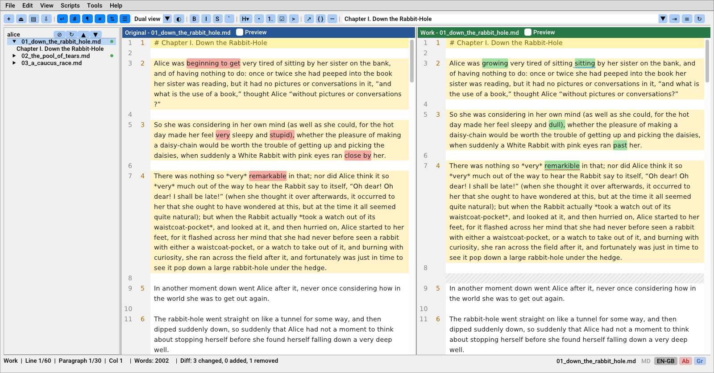
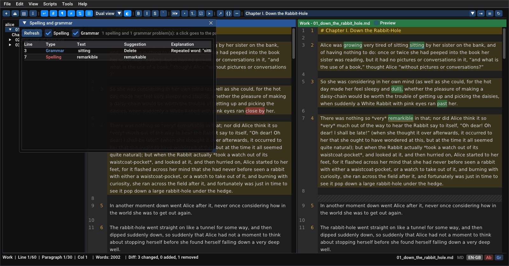
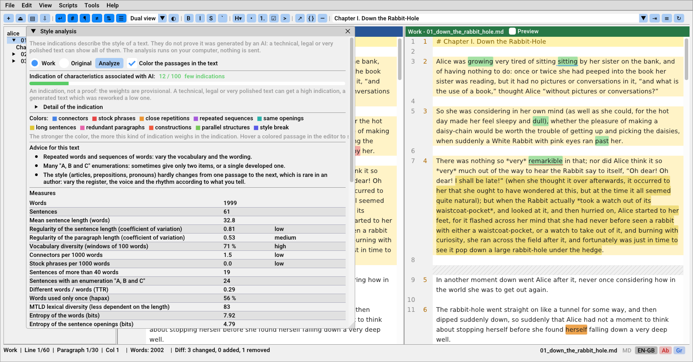
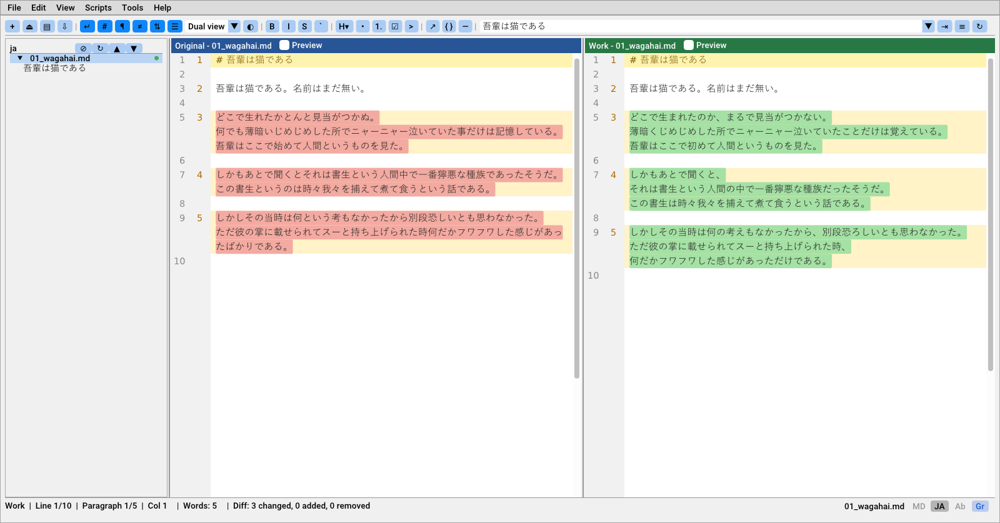
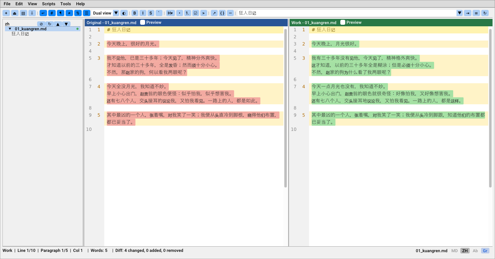

# Binote

*English version: [README.md](README.md).*

**Binote est un éditeur de bureau pour rédiger et réécrire un texte en double vue, avec correction orthographique, grammaticale et de style et suivi des versions.**

**[Télécharger la dernière version](https://github.com/rebisway/binote/releases/latest)** (Windows, installateur ou zip).

Texte brut ou Markdown, un seul fichier ou un livre entier (un fichier par chapitre). Tout se passe sur votre ordinateur : pas de compte, pas d'envoi de texte, pas de modèle d'IA.



## Trois points forts

- **L'original reste sous les yeux.** Votre texte à droite, l'original à gauche, les paragraphes face à face et les différences colorées. La simple vue permet d'écrire sans lui.
- **Chaque version est gardée.** Chaque enregistrement va dans un historique : rétablir une seule modification, repartir d'une version ou l'exporter. Vous travaillez dans vos propres fichiers, que Git et Subversion suivent donc.
- **La correction pendant la rédaction.** Orthographe, grammaire, analyse de style et typographie automatique, le tout sur votre ordinateur.

Binote propose aussi des boutons et un aperçu Markdown, la recherche et le remplacement avec expressions régulières, des scripts Python, des notes et des statistiques, l'export en PDF, Word, EPUB, HTML, Markdown et texte brut, et gère le chinois, le japonais et le coréen. Le [manuel](docs/MANUAL.md) (en anglais) décrit tout.

<p>


</p>

Texte japonais et chinois, en double vue (les premières lignes de *Je suis un chat* et du *Journal d'un fou*, dans le domaine public) :

<p>


</p>

## Pour commencer

1. [Téléchargez la dernière version](https://github.com/rebisway/binote/releases/latest), installez-la ou décompressez-la, et lancez `binote.exe` (l'installateur n'est pas signé : Windows SmartScreen peut demander une confirmation). Python 3.12 ou plus récent est facultatif, pour les scripts et le correcteur grammatical complet. Pour compiler vous-même, voir la section de compilation plus bas.
2. **Fichier > Ouvrir un fichier** (un `.md` ou un `.txt`) ou **Ouvrir un dossier** (un fichier par chapitre). Vous travaillez dans ces fichiers ; Binote garde une copie des originaux, son fichier de projet et l'historique dans un dossier caché `.src`. **Fichier > Nouveau fichier** (Ctrl+N) part d'une page blanche.
3. Écrivez dans le volet *Travail*. La liste déroulante de la barre d'outils choisit la vue ; **Ctrl+F7** et **Ctrl+F8** activent l'orthographe et la grammaire ; **F7** corrige la typographie du paragraphe.

Un projet d'exemple (les premiers chapitres d'*Alice au pays des merveilles*, en anglais, et une courte réécriture) est dans [`docs/sample`](docs/sample) ; voir [`docs/SAMPLE_CREDITS.txt`](docs/SAMPLE_CREDITS.txt).

## Compilation

Binote est écrit en C++17 avec [Dear ImGui](https://github.com/ocornut/imgui) et GLFW. Il se compile avec Visual Studio (ouvrez `binote.sln`) ou avec CMake :

```
cd binote-app
cmake -S . -B build -G Ninja -DCMAKE_BUILD_TYPE=Release
cmake --build build
```

Dear ImGui et ImGuiColorTextEdit sont dans `third/`, Hunspell dans `binote-app/third`. GLFW et les en-têtes de Python sont lus dans le dossier donné par `BINOTE_THIRD_DIR` (CMake) ou `ThirdPartyDir` (Visual Studio). **Python 3.12 ou plus récent est facultatif** : il est chargé la première fois qu'un script ou le correcteur grammatical sert. Le dossier `grammar-engine` est copié à côté de l'exécutable par la compilation. Binote est compilé et testé sous Windows. Tous les détails sont dans [docs/BUILD.md](docs/BUILD.md) (en anglais).

## Documentation

La documentation est en anglais, sauf la référence de l'API du moteur grammatical, qui existe aussi en français.

- [Manuel de l'utilisateur](docs/MANUAL.md)
- [Architecture](docs/ARCHITECTURE.md) : l'organisation de `binote-app/src`, le flux de données, la passerelle vers Python
- [Compilation](docs/BUILD.md) : prérequis, bibliothèques tierces, CMake, Visual Studio
- [Tests](docs/TESTING.md) : le pont de test et ses commandes, les tests du moteur, les captures d'écran
- [Langues de l'interface](docs/LANGUAGES.md) : le format des fichiers de langue, comment ajouter une langue
- [Scripts](binote-app/scripts/README_scripts.txt) : le contrat d'un script
- **Le moteur de typographie** : [README et format des profils](typography-engine/README.md)
- **Le moteur grammatical** : [README](grammar-engine/README.md), [référence de l'API](grammar-engine/docs/API.fr.md) ([English](grammar-engine/docs/API.en.md)), [architecture](grammar-engine/docs/ARCHITECTURE.md), [écrire une langue](grammar-engine/docs/WRITING_A_LANGUAGE.md), [format du lexique](grammar-engine/docs/LEXICON.md), [fabriquer les lexiques](grammar-engine/docs/BUILDING_LEXICONS.md), [règles](grammar-engine/docs/RULES.md), [exemples d'interfaces en six langages](grammar-engine/examples/README.md)

## Organisation du dépôt

| Dossier | Contenu |
| --- | --- |
| `binote-app` | L'application (`src/ui`, `src/common`, `src/project`, `src/analysis`, `src/export`, `src/script`, `src/vcs`), dictionnaires, langues, scripts |
| `typography-engine` | La typographie automatique (C++, MIT) : un profil par langue, à la frappe ou sur un texte. Indépendant de Binote |
| `grammar-engine` | Le correcteur grammatical (Python, MIT) : règles par langue, étiqueteur, lexiques, exemples. Indépendant de Binote |
| `imgui-md` | Composant Markdown pour Dear ImGui (MIT), indépendant |
| `imgui-prose` | Composant d'édition de prose pour Dear ImGui (MIT), indépendant |
| `third` | Dear ImGui et ImGuiColorTextEdit, avec leurs propres licences |
| `docs` | Manuel, captures d'écran, projet d'exemple |

## Licences

Binote est un logiciel libre sous **licence publique générale GNU Affero 3.0 ou ultérieure** (voir [LICENSE](LICENSE)). `imgui-md`, `imgui-prose` et `grammar-engine` sont sous licence MIT. Les composants tiers gardent leur licence : Dear ImGui, GLFW, md4c, stb, ImGuiColorTextEdit (MIT), Hunspell (MPL/GPL/LGPL), le lexique de Grammalecte (MPL 2.0), les polices DejaVu et Roboto, et les lexiques anglais et espagnol du moteur grammatical (issus de Wiktionnaire, CC BY-SA 4.0) ; les mentions sont dans [grammar-engine/THIRD_PARTY_LICENSES.md](grammar-engine/THIRD_PARTY_LICENSES.md).

© 2026 Thomas Gourgnier - [www.rebisway.com](https://www.rebisway.com)
