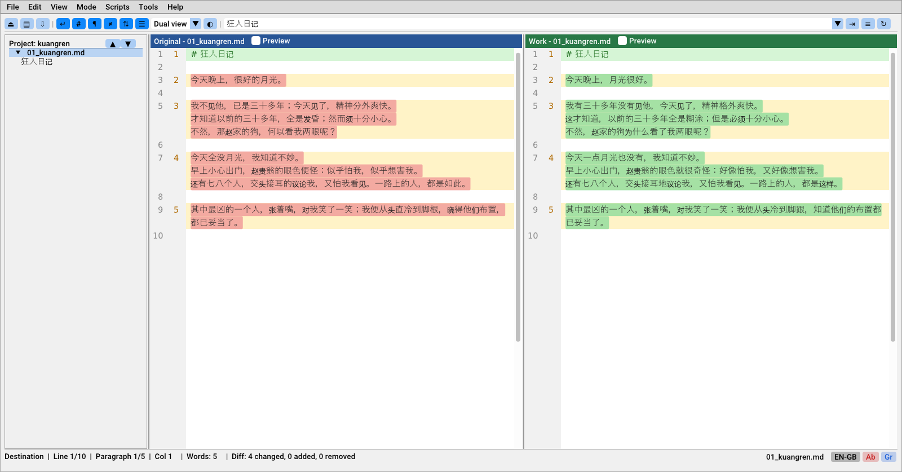

# Binote

*Version française : [README.fr.md](README.fr.md).*

**Binote is a desktop editor for rewriting, revising and proofreading a text, paragraph by paragraph.** The original stays on the left, read-only; your version is on the right. Binote keeps the two aligned, shows what changed, and helps you polish the result with spelling and grammar checkers, French typography, a style analysis, Python scripts, a history of every version and export.

Plain text or Markdown, a single file or a whole book (one file per chapter). Everything runs on your computer: no account, no upload, no model.


## Objective

Binote is made to rewrite a text paragraph by paragraph while keeping the original in view: reworking a draft, polishing a translation, revising a book chapter by chapter. It also works as an ordinary editor, in a single view, to write, proofread or read a text on its own.

## Features

**Views and navigation**
- **Dual view, or single view** (the combo box of the toolbar): *Original*, *Work* or both. In the dual view the paragraphs stay facing each other even when you add or remove some; the panes scroll together.
- **Projects**: a single file, or a folder of chapters with an outline tree (`binote.json`); line and paragraph numbers, the current paragraph highlighted, go to a line, table of contents.
- **Markdown preview** with images and diagrams; **links** are followed (a Markdown file opens in Binote, a web address opens the browser).
- Light and dark themes, interface in English, French and Spanish.
- **Chinese, Japanese and Korean text**: a fallback font (found on the system, or chosen in the preferences), the line breaking rules of East Asian text (kinsoku) and the position of the caret given to the input method.

**Checking and typography**
- **Spelling** (Hunspell) and **grammar**: a Python engine of independent rules, one file per language, with a tagger and a lexicon for French, English and Spanish (variants such as Argentine Spanish derive from their language). The mistakes are underlined and listed with their line numbers. The engine is a [separate component](grammar-engine).
- **Style analysis**: repetitions, stock phrases, regularity of the sentences, vocabulary, readability... observations with the passages coloured in the text, and advice. An indication, never a verdict.
- **French typography** while you type (« », no-break spaces, ’ and …) or on demand for a paragraph or a chapter.
- **Invisible characters** shown with a colour per kind (no-break, thin and zero-width spaces, soft hyphen...), and a character table.

**Working tools**
- **Find and replace** with regular expressions and escapes, in the file or in all the chapters.
- **Python scripts** applicable to the selection, a paragraph, a section, a file or the project, with a dialog, an editor and a preview; ready-made scripts for quotes, title case, lists, no-break spaces...
- **Notes** on paragraphs, **proper names** found in the project, **statistics** and **objectives** in words.
- **History** of every saved version, with differences and restore.
- **Git and Subversion** (status, commit, update, push, log, differences).
- **Export** to PDF, Word, EPUB 3, HTML or a single Markdown file, with no external library.

<p>


</p>

Japanese and Chinese text, in the dual view (the first lines of *I Am a Cat* and of *Diary of a Madman*, public domain):

<p>


</p>

## Quick start

1. Build Binote (below) and run `binote.exe`.
2. **File > Open a file** (a `.md` or `.txt`) or **Open a folder** (one file per chapter). The first time, Binote asks where to write your version and creates a `binote.json`.
3. Write in the right pane. The combo box of the toolbar chooses the view; **Ctrl+F7** and **Ctrl+F8** switch the spelling and the grammar; **F7** fixes the typography of the paragraph.

A sample project (the first chapters of *Alice's Adventures in Wonderland* and a short rewrite) is in [`docs/sample`](docs/sample); see [`docs/SAMPLE_CREDITS.txt`](docs/SAMPLE_CREDITS.txt).

## Build

Binote is written in C++17 with [Dear ImGui](https://github.com/ocornut/imgui) and GLFW. It builds with Visual Studio (open `binote.sln`) or with CMake:

```
cd binote-app
cmake -S . -B build -G Ninja -DCMAKE_BUILD_TYPE=Release
cmake --build build
```

Dear ImGui and ImGuiColorTextEdit are in `third/`, Hunspell in `binote-app/third`. GLFW and the Python headers are read from the folder given by `BINOTE_THIRD_DIR` (CMake) or `ThirdPartyDir` (Visual Studio). **Python 3.12 or later is optional**: it is loaded the first time a script or the grammar checker is used. The `grammar-engine` folder is copied beside the executable by the build. Binote is built and tested on Windows. All the details are in [docs/BUILD.md](docs/BUILD.md).

## Documentation

- [User manual](docs/MANUAL.md) (in English)
- [Architecture](docs/ARCHITECTURE.md): the layout of `binote-app/src`, the data flow, the bridge to Python
- [Building](docs/BUILD.md): prerequisites, third party libraries, CMake, Visual Studio
- [Testing](docs/TESTING.md): the test bridge and its commands, the engine tests, the screenshots
- [Interface languages](docs/LANGUAGES.md): the format of the language files, how to add a language
- [Scripts](binote-app/scripts/README_scripts.txt): the contract of a script
- **The grammar engine**: [README](grammar-engine/README.md), [API reference](grammar-engine/docs/API.en.md) ([français](grammar-engine/docs/API.fr.md)), [architecture](grammar-engine/docs/ARCHITECTURE.md), [writing a language](grammar-engine/docs/WRITING_A_LANGUAGE.md), [lexicon format](grammar-engine/docs/LEXICON.md), [building the lexicons](grammar-engine/docs/BUILDING_LEXICONS.md), [rules](grammar-engine/docs/RULES.md), [examples of interfaces in six languages](grammar-engine/examples/README.md)

## Layout of the repository

| Folder | Content |
| --- | --- |
| `binote-app` | The application (`src/ui`, `src/common`, `src/project`, `src/analysis`, `src/export`, `src/script`, `src/vcs`), dictionaries, languages, scripts |
| `grammar-engine` | The grammar checker (Python, MIT): rules by language, tagger, lexicons, examples. Independent of Binote |
| `imgui-md` | Markdown component for Dear ImGui (MIT), independent |
| `imgui-prose` | Prose editor component for Dear ImGui (MIT), independent |
| `third` | Dear ImGui and ImGuiColorTextEdit, with their own licenses |
| `docs` | Manual, screenshots, sample project |

## Licenses

Binote is free software under the **GNU Affero General Public License 3.0 or later** (see [LICENSE](LICENSE)). `imgui-md`, `imgui-prose` and `grammar-engine` are MIT. The third party components keep their own licenses: Dear ImGui, GLFW, md4c, stb, ImGuiColorTextEdit (MIT), Hunspell (MPL/GPL/LGPL), the lexicon of Grammalecte (MPL 2.0), the fonts DejaVu and Roboto, and the English and Spanish lexicons of the grammar engine (from Wiktionary, CC BY-SA 4.0); the notices are in [grammar-engine/THIRD_PARTY_LICENSES.md](grammar-engine/THIRD_PARTY_LICENSES.md).

© 2026 Thomas Gourgnier - [www.rebisway.com](https://www.rebisway.com)
