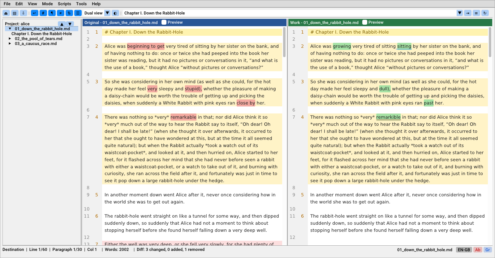
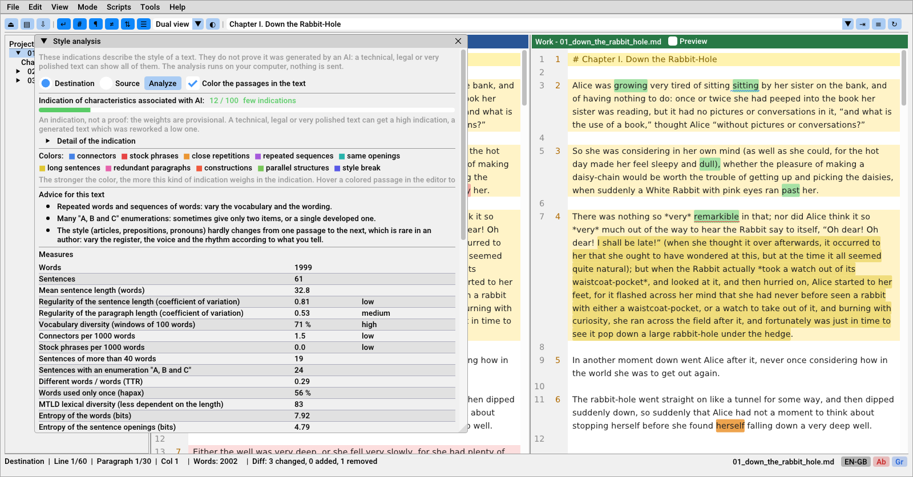

# Binote

A desktop editor for **rewriting a text paragraph by paragraph**. The original stays on the left, read-only; your rewrite is on the right. Binote keeps the two aligned, shows what changed, and helps you polish the result: spelling, grammar, French typography, style analysis, Python scripts, history and export.

Binote is not only for rewriting. The same window is also a **single-view editor** for writing, proofreading and reading, with no original beside it: show only your text (*Work*) or only the original (*Original*), and keep everything else (spelling, grammar, style analysis, French typography, search, scripts, history, export). The combo box of the toolbar switches between the single views and the dual view at any time.

Single files or whole books (one file per chapter), plain text or Markdown. Everything runs on your computer: no account, no upload.



## Features

- **Single view or double view**: your text alone, the original alone, or both. In the double view, source (read-only) and destination (editable), scrolling together, paragraphs kept facing each other even when you add or remove some. Differences are coloured, down to the word.
- **Projects**: a single file, or a folder of chapters with an outline tree (`binote.json`).
- **Spelling** (Hunspell) and **grammar** (a Python engine of independent rules, one file per language, with a tagger and lexicons for French, English and Spanish; variants such as Argentine Spanish derive from their language), with a [list of the problems](docs/MANUAL.md#spelling-and-grammar) and their line numbers. The engine is a [separate component](grammar-engine).
- **Style analysis**: repetitions, stock phrases, regularity of the sentences, vocabulary, readability... observations with the passages coloured in the text and advice. An indication, never a verdict.
- **French typography** while you type: « », no-break spaces, ’ and …
- **Python scripts** applicable to the selection, a paragraph, a section, a file or the project, with a dialog, an editor and a preview. Ready-made scripts for quotes, title case, lists, no-break spaces...
- **Find and replace** with regular expressions, escapes (`\t`, `\n`, ` `) and a table of characters.
- **History** of every saved version, with differences and restore.
- **Notes** on paragraphs, **names** found in the project, **objectives** in words, **statistics**.
- **Git and Subversion** (commit, update, push, log, differences).
- **Export** to PDF, Word, EPUB 3, HTML or a single Markdown file, with no external library.
- Markdown **preview**, reading mode, light and dark themes, interface in English, French and Spanish.

<p>


</p>

## Download and build

Binote is written in C++17 with [Dear ImGui](https://github.com/ocornut/imgui) and GLFW. The project builds with Visual Studio (open `binote.sln`) or with CMake:

```
cd binote-app
cmake -S . -B build -G Ninja -DCMAKE_BUILD_TYPE=Release
cmake --build build
```

The third party libraries (Dear ImGui, GLFW, the Python headers and ImGuiColorTextEdit) are read from the folder given by `BINOTE_THIRD_DIR` (CMake) or `ThirdPartyDir` (Visual Studio). Hunspell is in `binote-app/third`. Python 3.12 or later is optional: it is loaded the first time a script or the grammar checker is used. The `grammar-engine` folder is copied beside the executable by the build.

Run `binote.exe`, or open a file or a folder from the **File** menu. A sample project is in [`docs/sample`](docs/sample) (see [`docs/SAMPLE_CREDITS.txt`](docs/SAMPLE_CREDITS.txt)).

## Documentation

- [User manual](docs/MANUAL.md)
- [Architecture](docs/ARCHITECTURE.md): the layout of `binote-app/src`, the data flow, the bridge to Python
- [Building](docs/BUILD.md): prerequisites, `BINOTE_THIRD_DIR`, CMake, Visual Studio
- [Testing](docs/TESTING.md): the test bridge and its commands, the engine tests, the screenshots
- [Interface languages](docs/LANGUAGES.md): the format of the language files, how to add a language
- [Scripts](binote-app/scripts/README_scripts.txt)
- The grammar engine: [README](grammar-engine/README.md), [API reference](grammar-engine/docs/API.en.md) ([français](grammar-engine/docs/API.fr.md)), [architecture](grammar-engine/docs/ARCHITECTURE.md), [writing a language](grammar-engine/docs/WRITING_A_LANGUAGE.md), [lexicon format](grammar-engine/docs/LEXICON.md), [rules](grammar-engine/docs/RULES.md), [examples in six languages](grammar-engine/examples/README.md)

## Layout of the repository

| Folder | Content |
| --- | --- |
| `binote-app` | The application (`src/ui`, `src/common`, `src/project`, `src/analysis`, `src/export`, `src/script`, `src/vcs`), dictionaries, lexicon, languages, scripts |
| `imgui-md` | Markdown component for Dear ImGui (MIT), independent |
| `imgui-prose` | Prose editor component for Dear ImGui (MIT), independent |
| `grammar-engine` | The grammar checker (Python, MIT): rules by language, tagger, lexicons. Independent of Binote |
| `docs` | Manual, screenshots, sample project |

## Licenses

Binote is free software under the **GNU Affero General Public License 3.0 or later** (see [LICENSE](LICENSE)). `imgui-md` and `imgui-prose` are MIT. The third party components keep their own licenses: Dear ImGui, GLFW, md4c, stb, ImGuiColorTextEdit (MIT), Hunspell (MPL/GPL/LGPL), the lexicon of Grammalecte (MPL 2.0), the fonts DejaVu and Roboto, the English and Spanish lexicons of the grammar engine (from Wiktionary, CC BY-SA 4.0).

© 2026 Thomas Gourgnier - [www.rebisway.com](https://www.rebisway.com)
