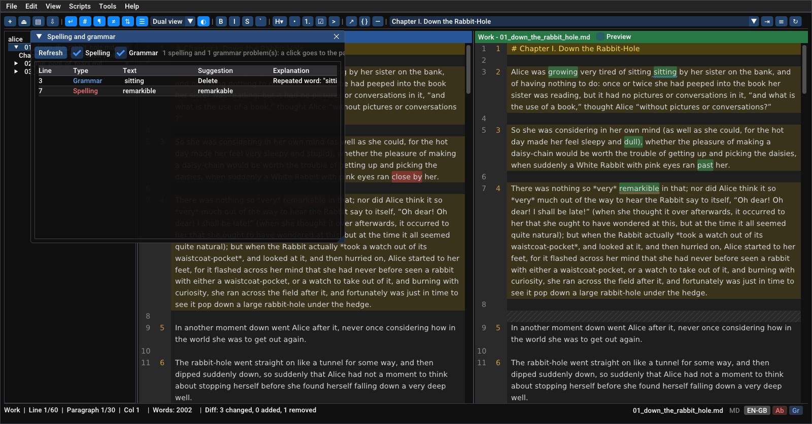

# Binote

*Version française : [README.fr.md](README.fr.md).*

**Binote is a desktop editor for writing and rewriting a text in a dual view, with spelling, grammar and style checking and version tracking.**

**[Download the latest version](https://github.com/rebisway/binote/releases/latest)** (Windows, installer or zip).

Plain text or Markdown, a single file or a whole book (one file per chapter). Everything runs on your computer: no account, no upload, no model.


## Three things it does well

- **The original stays in view.** Your text on the right, the original on the left, paragraphs facing each other and differences coloured. A single view is there to write without it.
- **Every version is kept.** Each save goes to a history: restore a single change, restart from a version or export it. You work in your own files, so Git and Subversion follow them.
- **Checking as you write.** Spelling, grammar, style analysis and automatic typography, all on your computer.

It also has Markdown buttons and preview, find and replace with regular expressions, Python scripts, notes and statistics, export to PDF, Word, EPUB, HTML, Markdown and plain text, and handles Chinese, Japanese and Korean text. The [user manual](docs/MANUAL.md) describes everything.

<p>


</p>

Japanese and Chinese text, in the dual view (the first lines of *I Am a Cat* and of *Diary of a Madman*, public domain):

<p>


</p>

## Quick start

1. [Download the latest version](https://github.com/rebisway/binote/releases/latest), install it or unzip it, and run `binote.exe` (the installer is not signed: Windows SmartScreen may ask for confirmation). Python 3.12 or later is optional, for the scripts and the full grammar checker. To compile it yourself, see [Build](#build).
2. **File > Open a file** (a `.md` or `.txt`) or **Open a folder** (one file per chapter). You work in these files; Binote keeps a copy of the originals, its project file and the history in a hidden `.src` folder. **File > New file** (Ctrl+N) starts from a blank page.
3. Write in the *Work* pane. The combo box of the toolbar chooses the view; **Ctrl+F7** and **Ctrl+F8** switch the spelling and the grammar; **F7** fixes the typography of the paragraph.

A sample project (the first chapters of *Alice's Adventures in Wonderland* and a short rewrite) is in [`docs/sample`](docs/sample); see [`docs/SAMPLE_CREDITS.txt`](docs/SAMPLE_CREDITS.txt).

## Build

Binote is written in C++17 with [Dear ImGui](https://github.com/ocornut/imgui) and GLFW. It builds with Visual Studio (open `binote.sln`) or with CMake:

```
cd binote-app
cmake -S . -B build -G Ninja -DCMAKE_BUILD_TYPE=Release
cmake --build build
```

Dear ImGui and ImGuiColorTextEdit are in `third/`, Hunspell in `binote-app/third`. GLFW and the Python headers are read from the folder given by `BINOTE_THIRD_DIR` (CMake) or `ThirdPartyDir` (Visual Studio). **Python 3.12 or later is optional**: it is loaded the first time a script or the grammar checker is used. The `grammar-engine` folder is copied beside the executable by the build. Binote is built and tested on Windows. All the details are in [docs/BUILD.md](docs/BUILD.md).

## Documentation

- [User manual](docs/MANUAL.md) (in English)
- [Architecture](docs/ARCHITECTURE.md): the layout of `binote-app/src`, the data flow, the bridge to Python
- [Building](docs/BUILD.md): prerequisites, third party libraries, CMake, Visual Studio
- [Testing](docs/TESTING.md): the test bridge and its commands, the engine tests, the screenshots
- [Interface languages](docs/LANGUAGES.md): the format of the language files, how to add a language
- [Scripts](binote-app/scripts/README_scripts.txt): the contract of a script
- **The typography engine**: [README and profile format](typography-engine/README.md)
- **The grammar engine**: [README](grammar-engine/README.md), [API reference](grammar-engine/docs/API.en.md) ([français](grammar-engine/docs/API.fr.md)), [architecture](grammar-engine/docs/ARCHITECTURE.md), [writing a language](grammar-engine/docs/WRITING_A_LANGUAGE.md), [lexicon format](grammar-engine/docs/LEXICON.md), [building the lexicons](grammar-engine/docs/BUILDING_LEXICONS.md), [rules](grammar-engine/docs/RULES.md), [examples of interfaces in six languages](grammar-engine/examples/README.md)

## Layout of the repository

| Folder | Content |
| --- | --- |
| `binote-app` | The application (`src/ui`, `src/common`, `src/project`, `src/analysis`, `src/export`, `src/script`, `src/vcs`), dictionaries, languages, scripts |
| `typography-engine` | The automatic typography (C++, MIT): one profile per language, while typing or on a text. Independent of Binote |
| `grammar-engine` | The grammar checker (Python, MIT): rules by language, tagger, lexicons, examples. Independent of Binote |
| `imgui-md` | Markdown component for Dear ImGui (MIT), independent |
| `imgui-prose` | Prose editor component for Dear ImGui (MIT), independent |
| `third` | Dear ImGui and ImGuiColorTextEdit, with their own licenses |
| `docs` | Manual, screenshots, sample project |

## Licenses

Binote is free software under the **GNU Affero General Public License 3.0 or later** (see [LICENSE](LICENSE)). `imgui-md`, `imgui-prose` and `grammar-engine` are MIT. The third party components keep their own licenses: Dear ImGui, GLFW, md4c, stb, ImGuiColorTextEdit (MIT), Hunspell (MPL/GPL/LGPL), the lexicon of Grammalecte (MPL 2.0), the fonts DejaVu and Roboto, and the English and Spanish lexicons of the grammar engine (from Wiktionary, CC BY-SA 4.0); the notices are in [grammar-engine/THIRD_PARTY_LICENSES.md](grammar-engine/THIRD_PARTY_LICENSES.md).

© 2026 Thomas Gourgnier - [www.rebisway.com](https://www.rebisway.com)
