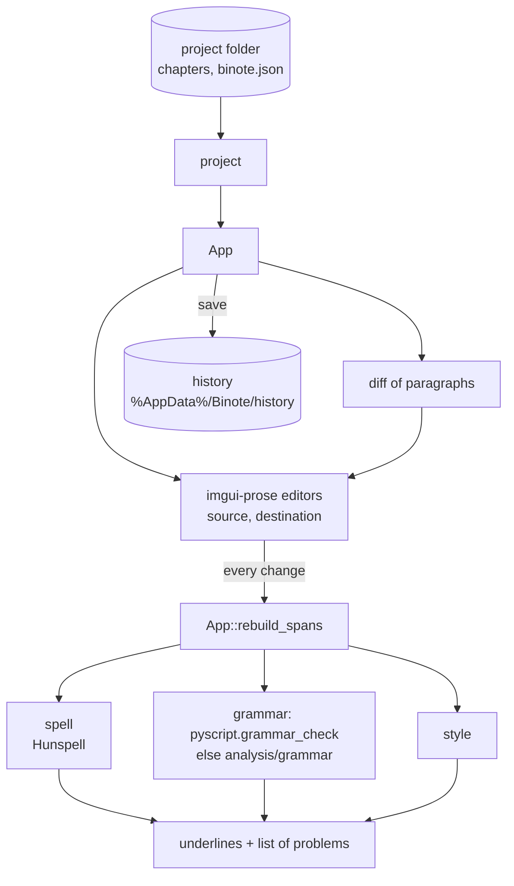
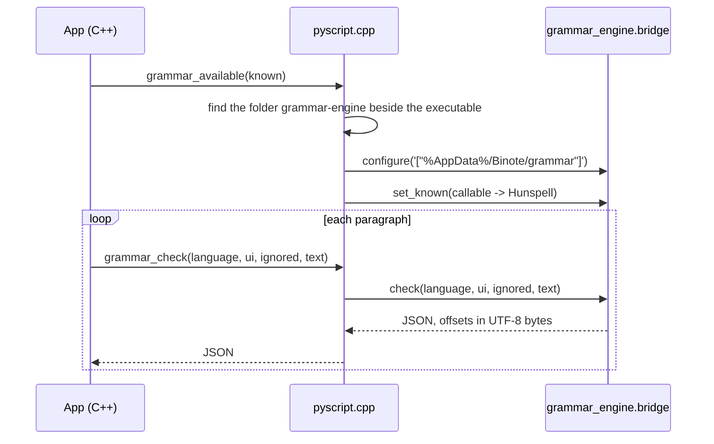

# Architecture of Binote

Binote is a C++17 application built on Dear ImGui and GLFW (OpenGL 3.3). This document describes the layout of `binote-app/src`, what each file is for, how data flows, and how the application reaches Python (scripts and the grammar engine). How to build it is in [BUILD.md](BUILD.md), how to test it in [TESTING.md](TESTING.md).

## The repository

| Folder | Content |
|---|---|
| `binote-app/` | the application: `src/`, `dict/` (Hunspell dictionaries), `lexicon/` (the C++ grammar lexicon), `lang/` (interface languages), `scripts/` (delivered Python scripts), `fonts/`, `icons/`, `third/hunspell` |
| `imgui-md/` | a Markdown component for Dear ImGui (MIT, depends on ImGui and md4c only) |
| `imgui-prose/` | a prose editor component for Dear ImGui (word wrap, paragraphs, decorations; MIT) |
| `grammar-engine/` | the grammar checker in Python, independent of Binote (see its own [README](../grammar-engine/README.md)) |
| `wpf-prototype/` | the first prototype (WPF), frozen: the reference specification |
| `docs/` | manual, screenshots, sample project |

The components never depend on `binote-app`.

## `binote-app/src`

Folder names are in English and match the filters of the Visual Studio project.

### `main.cpp`

Entry point: reads the command line (`--script FILE`, `--width W`, `--height H`, otherwise a file or folder to open), starts the log, creates the GLFW window (position and size of the last session), loads the fonts (a full text font with a fallback, merged with a symbol font), builds the `App` and runs the main loop. With `--script` the test bridge plays the commands of the file frame by frame, and can take screenshots (the framebuffer is written as a PNG).

### `ui/`: the application and its windows

| File | Role |
|---|---|
| `app.h`, `app.cpp` | `App`: the documents, the two panes (source and destination), the diff and the alignment of paragraphs, the project, find and replace, saving, state, and `App::command` (the application commands of the test bridge) |
| `app_ui.cpp` | the interface: menus, toolbar, status bar (position, words, objective, differences, language, the Ab and Gr switches), the tree, themes, dialogs, keyboard shortcuts |
| `app_problems.cpp` | spelling and grammar: the underlines in the destination, the list of problems (Ctrl+F9), the context menu |
| `app_script.cpp` | the Scripts menu, the dialog of the properties of a script, the changes made to the text, the script editor |
| `app_style_extra.cpp` | style analysis pages: source against destination, evolution of the indication over the history |
| `app_names.cpp` | the proper names of the project and their variants |
| `app_notes.cpp` | notes on paragraphs (`binote.notes`) |
| `app_charmap.cpp` | the table of characters |
| `app_export.cpp` | the export window |
| `app_vcs.cpp` | the Git and Subversion window |
| `bridge.h`, `bridge.cpp` | the test bridge: drives the running application like a user |

### `project/`: the text of a project

| File | Role |
|---|---|
| `project.*` | a project: one file or a folder with one chapter per file; headings (Markdown `#`, text "Chapter...", underlined titles); `binote.json` (name, destination, language, order) |
| `text.*` | French typography (« », ’, …, no-break spaces), the line and word diff, the table of contents, the history of saved versions |
| `search.*` | find and replace: plain text or regular expression, escapes, case, whole words; offsets are bytes of the UTF-8 text |

### `analysis/`: checking the text

| File | Role |
|---|---|
| `spell.*` | spelling with Hunspell (dictionaries in `dict`, the data folder of the user, LibreOffice); the personal dictionary `dictionary.txt` |
| `grammar.*` | the older **C++ grammar checker**: independent rules on tokens (French, English, Spanish). It is the fallback when Python or the engine is not available |
| `lexicon.*` | the reader of the C++ lexicon (`lexicon/fr.lex`, same BNLX format as the Python one) |
| `style.*` | the writing-style analysis: measures, stock phrases, repetitions, an indication with its reliability; offline, no model |

### `common/`

| File | Role |
|---|---|
| `util.*` | paths, files, settings (`settings.ini`) |
| `i18n.*`, `lang.*` | interface languages: `lang/<code>.txt` files of `KEY=value` lines ([LANGUAGES.md](LANGUAGES.md)) |
| `json.h` | a minimal JSON reader and writer (what the Python side sends) |
| `dialog.*` | the native open and save dialogs |
| `logger.*` | the log file, written by a dedicated thread |
| `stringex.h`, `strings.cpp`, `date.h`, `version.h` | string helpers, dates (Howard Hinnant's library), the version |

### `export/`, `script/`, `vcs/`

| File | Role |
|---|---|
| `export/exporter.*` | PDF (Times, no library), Word (.docx), EPUB 3, HTML, one Markdown file; the text is read into blocks (headings, paragraphs, list items) and written by each format |
| `script/pyscript.*` | embedded Python (stable ABI 3.12, loaded at the first use): scripts, the `Textcore` object, and the bridge to the grammar engine |
| `vcs/vcs.*` | Git and Subversion through their command line programs: status, commit, update/pull, push, log, differences |

## Data flow

- The **source** is read-only (except in reading mode, on request); the **destination** is what you write, in a `dst` folder or the one chosen for the project.
- At each change the paragraphs are compared with the source (`text.*` diff) and the panes are kept aligned; the alignments you declare are kept in `binote.align`.
- After each change the **problems** of the destination are rebuilt (`App::rebuild_spans`): Hunspell for spelling, the grammar engine for grammar, then the underlines and the list are updated. Rules the user ignored are passed to the engine as a comma-separated list. The analysis runs in the main thread; the grammar results are cached by paragraph text.
- Each **save** keeps a version in the history (`%AppData%\Binote\history`), with its differences.

## Python: scripts and the grammar engine

Python 3.12 or later is optional. `script/pyscript.cpp` loads `python3.dll` at the first use (delay-loaded on Windows) through the stable ABI, so any Python from 3.12 works.

- **Scripts** (`scripts/` beside the executable, and `%AppData%\Binote\scripts`): a script is a Python class `Textscript`; the object `Textcore` (`scripts/lib/textcore.py`) gives it the selection, a paragraph, a section, a file or the project. The contract is in `binote-app/scripts/README_scripts.txt`.
- **Grammar engine**: the build copies `grammar-engine/grammar_engine` beside the executable. The offsets the bridge returns are UTF-8 bytes, which the application indexes directly. When Python or the engine is missing, `analysis/grammar.*` is used. The reference of the engine is [../grammar-engine/docs/API.en.md](../grammar-engine/docs/API.en.md).

## Cache and state

- The grammar issues of a paragraph are cached by its text (`_grammar_cache`, up to 20,000 paragraphs); the cache is emptied when the language or the set of ignored rules changes, so a paragraph which did not change is not sent to the engine again.
- The Python engine keeps one checker per language and set of ignored rules (up to 16) and its lexicons stay loaded.
- The state of the session (window, last project, preferences) is in `settings.ini` in `%AppData%\Binote`; the objectives in `goals.ini`; the personal dictionary in `dictionary.txt`.
- In the project folder: `binote.json`, `binote.notes`, `binote.align`.

## Where things are written

See "Files written by Binote" in the [manual](MANUAL.md#files-written-by-binote).
