# Binote user manual

Binote is made to rewrite a text paragraph by paragraph, in a **dual view** (the original beside your text). It is just as much a **single-view editor**: write, proofread or read one text on its own, with the spelling and grammar checkers, the style analysis, the French typography, the search, the scripts, the history and the export. See [Single view or dual view](#single-view-or-dual-view). This manual follows the order of a work session. The screenshots show the sample project in [`sample`](sample): the first chapters of *Alice's Adventures in Wonderland* (Lewis Carroll, public domain) and a short rewrite.

- [The window](#the-window)
- [Single view or dual view](#single-view-or-dual-view)
- [The toolbar and the menus](#the-toolbar-and-the-menus)
- [Opening a text](#opening-a-text)
- [Rewriting](#rewriting)
- [Find and replace](#find-and-replace)
- [Spelling and grammar](#spelling-and-grammar)
- [Style analysis](#style-analysis)
- [Python scripts](#python-scripts)
- [History, notes, names, statistics](#history-notes-names-statistics)
- [Versions (Git and Subversion)](#versions-git-and-subversion)
- [Export](#export)
- [Display and preferences](#display-and-preferences)
- [Keyboard shortcuts](#keyboard-shortcuts)
- [Chinese, Japanese and Korean text](#chinese-japanese-and-korean-text)
- [Command line](#command-line)
- [Files written by Binote](#files-written-by-binote)

## The window

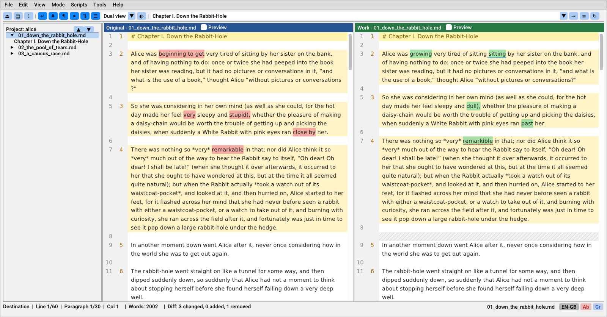

- **Left**: the project tree (chapters and their headings; a click goes there). **F9** shows or hides it.
- **Middle**: the **original**, the text you start from, read-only. Its title bar is blue.
- **Right**: the **work**, where you write. Its title bar is green.
- The two columns of numbers are the **line numbers** (grey) and the **paragraph numbers** (orange). A paragraph is a line which is not blank.
- The colours show the differences with the source: yellow, a paragraph which changed; green and red, the words added and removed; a hatched area, a paragraph which exists only on the other side. The panes scroll together and the paragraphs stay facing each other.
- The combo box of the toolbar chooses what is shown: **Original** (the original alone), **Work** (your text alone) or **Dual view** (both).
- The **status bar** gives the position, the words (of the selection, otherwise of the file), the objective if there is one, and the number of differences. At its right end are the **language of the text** (a click changes it) and two switches: **Ab** for the spelling (red when on) and **Gr** for the grammar (blue when on).

Dark theme (**Ctrl+T**):

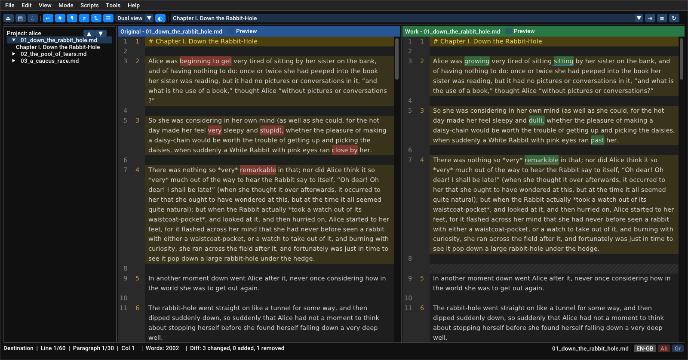

## Single view or dual view

The combo box of the toolbar (and the **View** menu: *Reading: original only*, *Destination only*) chooses what the window shows:

| Choice | What you see | Use it to |
| --- | --- | --- |
| **Dual view** | the original on the left, your text on the right, paragraphs facing each other, differences coloured | rewrite, translate, revise a text against its source |
| **Work** | your text alone, full width | write or proofread a text without a source: a new text, a chapter you are rewriting from memory, a text you have already finished comparing |
| **Original** | the original alone, read-only (tick *Edit* to correct it in place) | read the source, or use Binote as a reader with the outline, the search and the preview |

Everything else works in any of the three: the outline and the chapters, the line and paragraph numbers, find and replace, the spelling and grammar checkers and their list of problems, the style analysis, the French typography, the notes, the scripts, the history, the statistics and objectives, the version control and the export. Only the differences and the alignment of paragraphs belong to the dual view.

To write a text from nothing, open an empty or short file and choose *Work*: the destination is saved in the `dst` folder beside it, as usual.

## The toolbar and the menus

### The toolbar

From left to right (each button shows its name when the mouse stays on it):

| Button | Does |
| --- | --- |
| Open, Folder, Save | open a file, open a folder of chapters, save the work (Ctrl+O, Ctrl+Shift+O, Ctrl+S) |
| Wrap, Line no., No. ¶ | word wrap, line numbers, paragraph numbers |
| Differences, Sync | colour the differences with the original; scroll both panes together |
| Tree | show or hide the project tree (F9) |
| View mode (combo box) | *Original*, *Work* or *Dual view* |
| Dark | light or dark theme (Ctrl+T) |
| Chapter (combo box) | the heading where the caret is; choose another one to go there |
| Go to... | go to a line or a paragraph (Ctrl+G) |
| Contents | the table of contents of the project |
| Change history | the saved versions of the file (Ctrl+H) |

### The menus

| Menu | Items |
| --- | --- |
| **File** | Open a file, Open a folder, Recent files (and *Clear the list*), Save the destination, Versions (Git / SVN), Export, Save the destination as, Merge files, Reset the chapter from the source, Preferences, Destination folder, Quit |
| **Edit** | Undo, Redo; Find, Next match, Find in all chapters, Go to line / paragraph, Next / Previous paragraph, Next / Previous difference; Character map, Align with a paragraph of the other pane, Remove the alignments of the file, Note on the paragraph, List of the notes; Insert a no-break space, a narrow no-break space, guillemets « » |
| **View** | Word wrap, Line numbers, Paragraph numbers, Mark the differences, Synchronize source / destination, Align the paragraphs, Show no-break spaces, Show invisible characters; Project tree, Reading: original only, Destination only, Log, Open the log folder, Dark theme, Monospaced font in the editors; Current paragraph highlight, Highlight color, Language, Zoom in, Zoom out |
| **Mode** | Text or Markdown: how the file is read (Markdown headings and the preview, or plain text) |
| **Tools** | Statistics, Style analysis, Generate the table of contents, Proper names of the project, Change history, Add a version to the history; Language of the project text, Grammar checker, List of the problems, Switch the ignored rules on again, Spell checker, Automatic typography while typing, Fix the typography of the paragraph / of the chapter; Save when changing chapter |
| **Scripts** | the scripts by category, Edit the scripts, Refresh the list, Open the scripts folder |
| **Help** | About Binote (the version, the licence, the components, the Python which was found) |

The shortcuts are in [Keyboard shortcuts](#keyboard-shortcuts).

## Opening a text

- **File > Open a file** (Ctrl+O): a `.md`, `.markdown` or `.txt` file. The destination is a file named after the source in a `dst` folder, created at the first save. **File > Recent files** lists the last ones, with their destination as a tip.
- **File > Open a folder** (Ctrl+Shift+O): a multi-chapter project, one file per chapter. The first time, Binote asks for the destination folder and writes a `binote.json` file. The chapters can be reordered with the arrows of the tree.
- A file given by the system (double click, *Open with*) opens as chosen in the preferences: reading, preview or normal editing.
- **File > Merge files** writes all the chapters in one file. **File > Destination folder** changes where the work is written; **File > Save the destination as** saves a copy under another name.
- **Tools > Save when changing chapter** saves the work by itself when you go to another chapter (otherwise Binote asks).
- The language of the text (dictionary, typography, grammar) is set in **Tools > Language of the project text**, or with the language button at the right of the status bar. It is not the language of the interface (**View > Language**).

  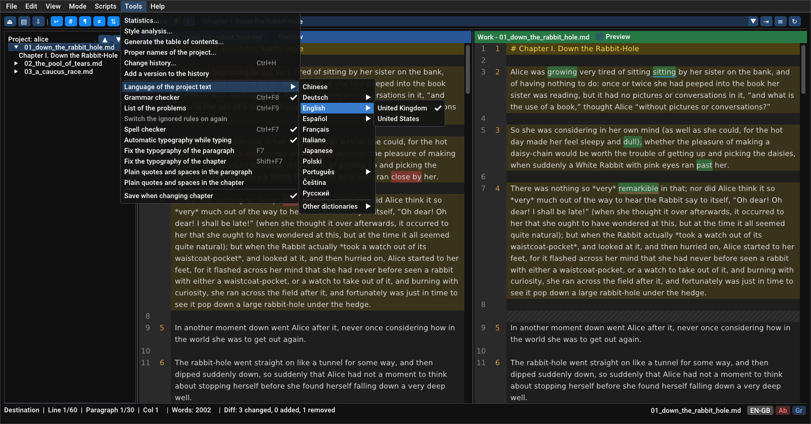

  Languages with several countries are submenus, named by country. **Other dictionaries** lists the ones of LibreOffice and of the system.

## Rewriting

Type in the work. The original cannot be modified, except in the *Original* view (see below).

- **Go to** (Ctrl+G, **Edit** menu) a line or a paragraph. **Ctrl+Down / Ctrl+Up** move to the next and previous paragraph. **F8 / Shift+F8** jump to the next and previous difference.
- **Reset the chapter from the source** starts the rewrite again.
- **Automatic typography** (**Tools** menu): while typing, quotes become « », the no-break spaces are added before `; : ! ?`, `'` becomes ’ and `...` becomes … (rules of the French profile). Each language has a **profile** (`typography` folder beside the program; yours go in `%AppData%\Binote\typography`, see [typography-engine](../typography-engine/README.md)); a language without a profile only has the curly quotes. **F7** corrects the current paragraph, **Shift+F7** the whole chapter. The opposite exists in the **Tools** menu (**Plain quotes and spaces** in the paragraph or the chapter): every quotation mark becomes `"`, every apostrophe `'`, the ellipsis three dots, and the typographic spaces before the signs and inside the quotation marks are removed (useful before an export to a tool which does not like them). The key used for the double quote is chosen in the preferences; **Edit > Insert guillemets « »** inserts a pair around the selection.
  Profiles shipped with Binote:

  | Language | Quotation marks | Other rules |
  |---|---|---|
  | French | « » with narrow no-break spaces | no-break space before `; : ! ?`, ’, … |
  | English | “ ” | ’, … |
  | Spanish | « » | ¿ ¡ added at the start of the sentence, ’, … |
  | German, Swiss German | „ “, « » | ’, … |
  | Italian | « » | ’, … |
  | Portuguese, Portuguese (Portugal) | “ ”, « » | ’, … |
  | Polish, Czech, Russian | „ ”, „ “, « » | no-break space after the one-letter words, … |
  | Chinese, Japanese | not converted | full-width signs after Chinese or Japanese text, …… |

  To change a rule or add a language, copy a profile from the `typography` folder to `%AppData%\Binote\typography`, rename it with the code of the language (`nl.typo`) and edit it: the format is described in the [README of the engine](../typography-engine/README.md). A profile in your folder replaces the one shipped. The preferences (**General** tab, below the choice of the quotation marks) show the profile in use and have three buttons: **Copy it to edit it** (copies it to your folder), **Open your folder** and **Reload** (reads the profiles again after an edit). The project language `fr-CA` uses `fr-ca.typo` if there is one, else `fr.typo`.
- Spaces which look alike are shown if **Show no-break spaces** is on (**View** menu). Insert them with **Ctrl+Shift+Space** (no-break) and **Ctrl+Alt+Space** (narrow no-break), or with the character map.
- **Show invisible characters** (**View** menu) marks every invisible typographic character except the normal space, with one colour per kind. The submenu **Colour code of the invisible characters**, just below, shows the key.

  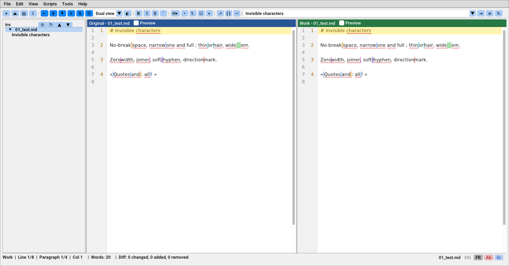

  | Colour | Characters |
  | --- | --- |
  | orange | no-break space (U+00A0) |
  | blue | narrow no-break space (U+202F) |
  | cyan | thin and hair spaces (U+2009, U+200A, U+2006) |
  | green | wide spaces: en, em, figure, ideographic (U+2000-U+2008, U+205F, U+3000) |
  | magenta | zero width: space, joiners, word joiner, BOM (U+200B-U+200D, U+2060, U+FEFF); drawn as a thin bar |
  | purple | soft hyphen (U+00AD) |
  | red | direction marks, line and paragraph separators, tab |

  Use it to find a space which looks right but is not the one you want (a no-break space where a normal one is needed, a zero-width character pasted from a web page). The colours can be changed in **Preferences > Colours**.
- **Align with a paragraph of the other pane** (Ctrl+Alt+A): when the program cannot tell which paragraph faces which, declare it. The alignments are kept in `binote.align`; **Edit > Remove the alignments of the file** forgets them. **View > Align the paragraphs** adds empty lines, which cannot be edited, where a paragraph exists on one side only, so that the paragraphs stay facing each other.
- **Original view** (Ctrl+R, or the combo box) shows the original alone. Its **Edit** check box allows correcting it in place. **Work** hides the original.
- **Preview**: the *Preview* check box of a pane shows the rendered Markdown, with images and diagrams. *Edit* goes back.

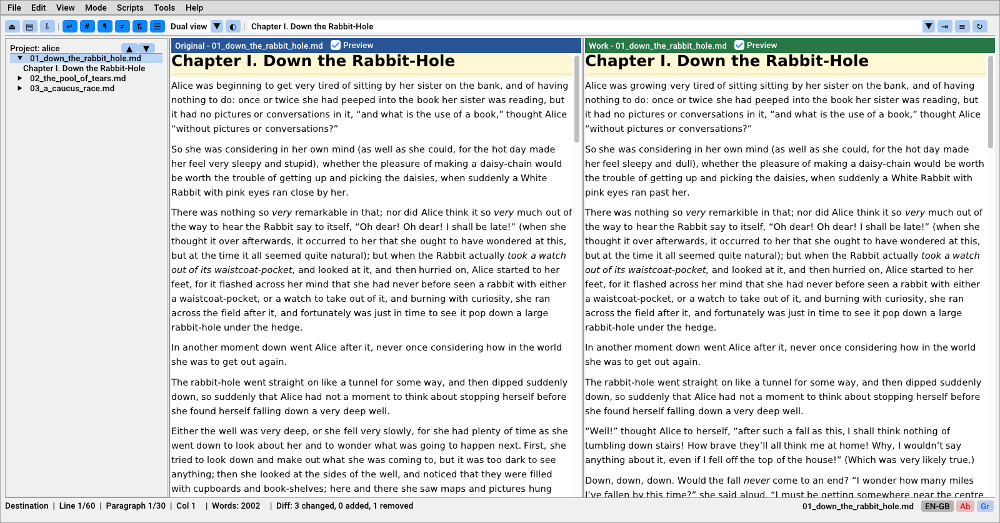

### Links

In the preview, a **click on a link** follows it; in the editor, **Ctrl+click** on a Markdown link (`[text](address)`) or on a web address does the same.

| The address is | What happens |
| --- | --- |
| a web address (`https://...`), a mail address (`mailto:...`) | the browser, or the mail program, opens it |
| a Markdown or text file (`02_chapter.md`, `../notes/idea.md`) | Binote opens it: as a chapter of the project if it is one, else as a file of its own |
| a file with an anchor (`02_chapter.md#second-part`) | the file opens at that heading |
| an anchor only (`#second-part`) | the text goes to that heading (the anchor is written like GitHub does: lower case, hyphens for spaces) |
| another file (an image, a PDF, a Word file) or a folder | the program of the system, or the file explorer |

A relative address is looked for beside the file of the pane, then beside the other one (the original and the work are in two folders). If the file does not exist the status bar says so. Other kinds of address (`javascript:` and the like) are not opened. If the text has unsaved changes, Binote asks or saves first, as when you change chapter.

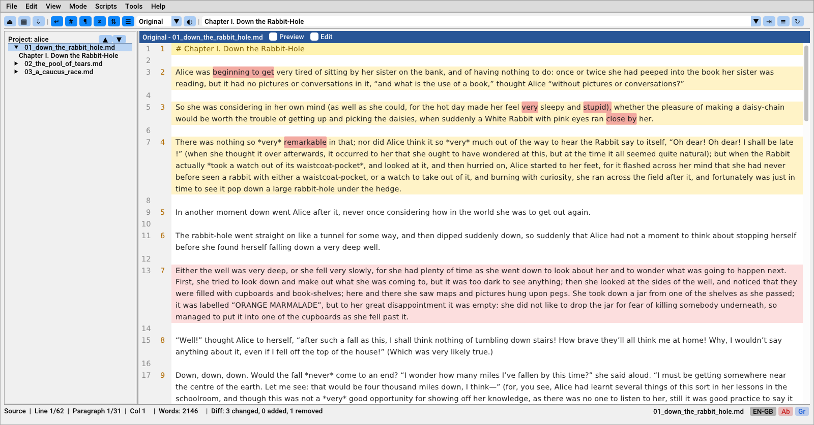

### Table of contents

The **Contents** button of the toolbar (or **Tools > Generate the table of contents**) builds the list of the headings of the project, with the chapters when there are several. In the window: **Copy** puts it in the clipboard, **Insert in the destination (caret)** writes it in the text, and, for a project of several chapters, **Write SOMMAIRE.md in the destination** writes it in a file of the destination folder.

### Character map

**Edit > Character map** (Ctrl+Shift+U): spaces and invisible characters, punctuation, letters, symbols, by group. A click inserts the character at the caret of the destination, or in the find box if it has the focus. The box *U+00A0* takes the code of any character (*Insert the code*), the recent characters are kept, and the list can be shown with any font of the system (the glyphs which the font lacks are dimmed).

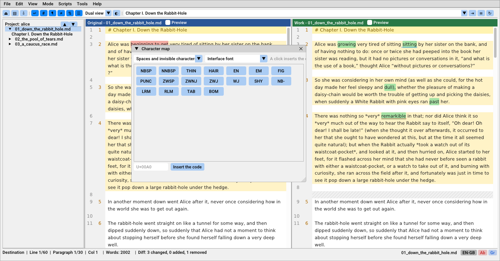

## Find and replace

**Ctrl+F** opens the search window; **F3** and **Shift+F3** go to the next and previous match. The search is made in the pane which has the focus (the window tells which, and how many matches there are). **Ctrl+Shift+F** (or the *All chapters* box) searches all the chapters and lists the results.

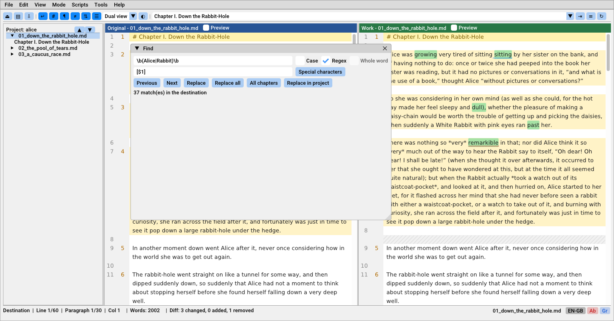

- **Case**, **Regex** (regular expressions; `$1` in the replacement is the first group) and **Whole word**.
- Escapes work in the two boxes: `\t`, `\n`, ` `, `\xHH`. The **Special characters** button inserts the invisible ones (no-break spaces, zero-width characters...) by name.
- **Replace all** is one step which Ctrl+Z undoes. **Replace in project** rewrites every chapter and keeps a version of each in the history.

## Spelling and grammar

- **Ctrl+F7** switches the spell checker (Hunspell) on and off, **Ctrl+F8** the grammar checker; the **Ab** and **Gr** buttons at the right of the status bar do the same. Mistakes are underlined in the work: red for spelling, blue for grammar.
- A **right click** on an underlined passage gives the suggestions, *Add to dictionary*, *Ignore*, and for grammar *Ignore this rule*.
- **Ctrl+F9** opens the list of the problems (**Tools > List of the problems**; its *Spelling* and *Grammar* boxes choose what is listed).
- *Ignore this rule* is remembered; **Tools > Switch the ignored rules on again** forgets what was ignored.

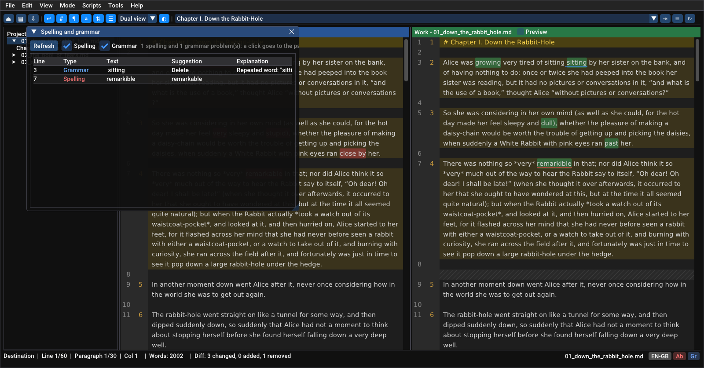

The list gives, for each problem, the line, the type, the text, the proposed correction and the explanation. A click selects the passage in the destination. It is updated a moment after each change.

Binote ships the dictionaries of French, English (US, UK), Spanish (Spain, Argentina), German, Italian, Portuguese (Brazil, Portugal), Polish, Czech and Russian (`dict` folder, downloaded when Binote is built, licenses in [`binote-app/dict`](../binote-app/dict/README_dictionaries.md)). Others go in `dict` of the data folder of the user (`%AppData%\Binote\dict`); those of LibreOffice and of the system are found too, and listed apart under **Other dictionaries** in the language menu.

### The grammar engine

The grammar checker is a separate component, [`grammar-engine`](../grammar-engine), written in Python (standard library only, offline, no model). Binote starts it the first time it is needed, with the same Python 3.12 or later as the scripts; without Python the older rules of Binote itself (a smaller set) are used. A language is one Python file with its own rules, so each language has the errors which belong to it:

- **French**: agreement (determiner and noun, also when the noun is a verb form like *les pomme*; noun and adjective, attribute, subject and verb, adjective before the noun, *tout*, *ma amie*, *quelque* and *quelques*, *la plupart des*, *moi qui*), past participles (with *être*, with *avoir* and a preceding object, pronominal verbs, *que*), homophones (ce / se, a / à, ou / où, leur / leurs, la / là, sa / ça, c'est / s'est, et / est, peu / peut, ma / m'a, tu a / tu as), elision (*si il*, *je ai*, *le homme*, *de un*), tenses (*si* followed by the conditional, the subjunctive after *il faut que* or *bien que*), prepositions (*essayer à*, *pallier à*, *différent que*), number words (*deux cent personnes*, *quatre-vingt ans*), fixed expressions and common unaccented words (*tres*, *deja*).
- **English**: subject and verb (*he go*, *I is*, *he don't*, *the dogs runs*, *everyone are*, *there is many*), determiner and noun (*a books*, *these book*), participles (*have went*, *I seen*, *if I would have known*), *to* and *too*, *loose* and *lose*, *its* and *it's*, *their* and *there*, missing apostrophes, a / an, then / than, *fewer* and *less*, irregular forms (*goed*, *runned*), non-standard phrases (*between you and I*, *depend of*).
- **Spanish**: determiner and noun (also for *las casa*), noun and adjective, noun subject and verb (*los niños juega*), pronoun and verb, the participle after *haber*, the subjunctive after verbs of wish (*quiero que vienes*), dequeísmo (*pienso de que*), impersonal *haber* (*habían muchas personas*, *hubieron*), *echo* and *hecho*, accents (*informacion*, *tambien*, *¿donde?*), *tu* / *tú*, ¿ ¡; Argentine Spanish adds the voseo.
- **Any language**: repeated words, a capital letter at the start of a sentence.

The engine reads the lexicon of the language (`grammar-engine/grammar_engine/data`): every form of every word with its lemma, part of speech, gender, number, person and tense. A tagger chooses the right reading of each word in its sentence (*le* is a pronoun in *il le porte* and a determiner in *il porte le sac*). The French lexicon comes from Grammalecte (MPL 2.0), the English and Spanish ones from Wiktionary through kaikki.org (CC BY-SA 4.0).

A **variant** of a language only holds what differs: `es_ar.py` (Argentine Spanish, with the voseo) derives from `es.py` and inherits its rules, messages and lexicon. A language of your own goes in `%AppData%\Binote\grammar` and replaces the delivered one of the same code. The way to write one is in [Writing a language](../grammar-engine/docs/WRITING_A_LANGUAGE.md); every rule is listed in the [catalogue of the rules](../grammar-engine/docs/RULES.md) and the calls of the engine in its [API reference](../grammar-engine/docs/API.en.md).

## Style analysis

**Tools > Style analysis** measures the text and explains what it finds: not whether it is good, and never *who* wrote it.

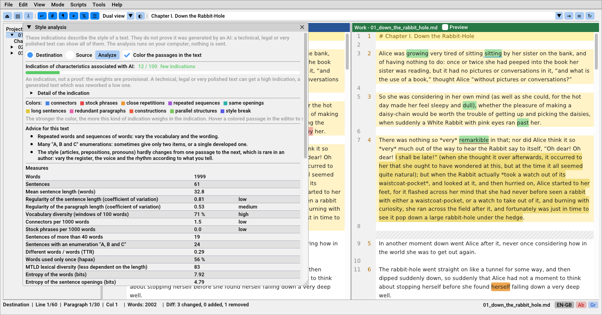

- The **indication** (0 to 100) sums up some characteristics which are often associated with generated or mechanical text. It is an indication, not a proof: a technical, legal or very polished text can get a high one. Its reliability depends on the length of the text.
- **Detail of the indication** gives the contribution of each characteristic.
- **Colors** marks the passages in the work (or the original): stock phrases, connectors, close repetitions, repeated sequences, identical sentence openings, long sentences, redundant paragraphs, constructions, parallel structures, breaks of style. The stronger the colour, the more it weighs.
- **Advice** says what to change; **Measures** lists the figures: sentence length and its regularity, vocabulary diversity, hapax, entropy, readability, passive voice...
- Two more pages compare the original with the work (*Analyze both texts*: indication, words, length and regularity of the sentences, vocabulary diversity, connectors and stock phrases per 1000 words, long sentences, words which the previous word lets you guess) and show the **evolution of the indication** over the saved versions (*Analyze the history of the file*).

## Python scripts

The **Scripts** menu lists the scripts by category (*Refresh the list* reads the folders again, *Open the scripts folder* shows yours). A script works on the selection, a paragraph, a section, a file or the whole project: the *Apply to* choice is in its dialog box.

Python is optional and is not installed with Binote. When it is missing, a window says so, with a button to [python.org/downloads](https://www.python.org/downloads/): at the first start, then once per session when you open the **Scripts** menu or switch the grammar checker on. Tick *Do not remind me again* to stop it. Install Python 3.12 or later with *Add python.exe to PATH* ticked, then restart Binote; without Python the grammar checker uses a smaller set of rules.

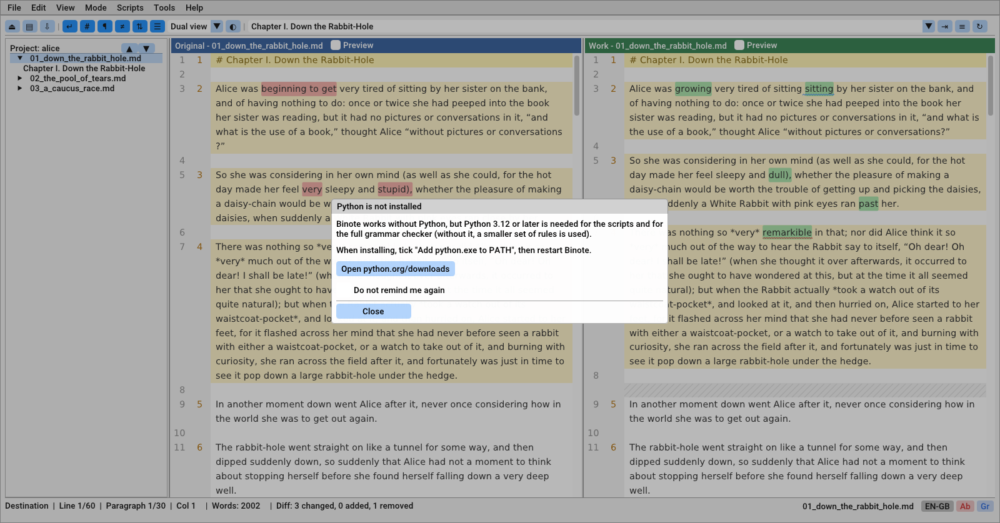

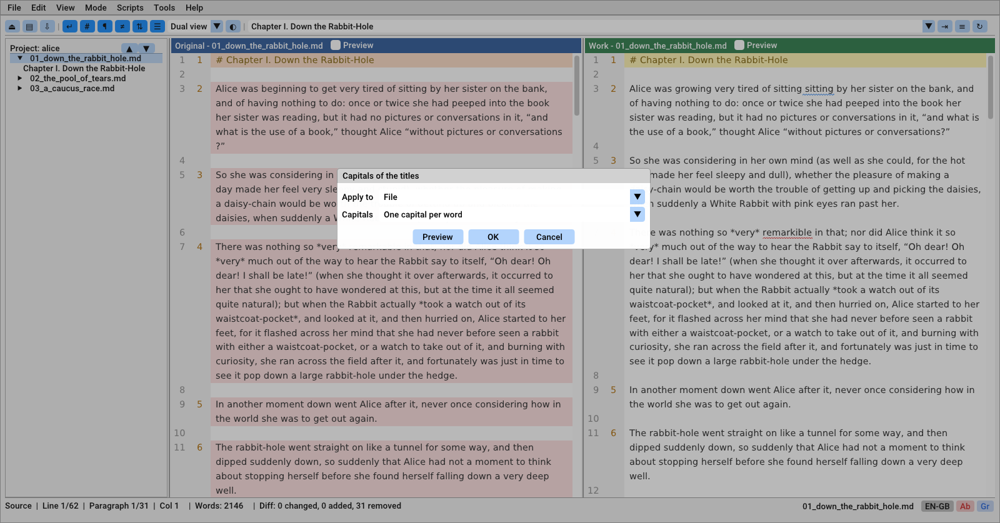

Scripts delivered with Binote:

| Script | What it does |
| --- | --- |
| Quotes to guillemets | `"text"` to « text », with or without no-break spaces |
| Capitals of the titles | one capital per word, or on the first word only |
| No-break spaces | adds the missing ones (French typography) |
| Lists | turns paragraphs into bullet or numbered lists |
| Fix spaces, blank lines, join lines, sentences to lines | cleaning |
| Apostrophes and ellipsis | ’ and … |
| Count the words | counts, in its own tkinter window |

Every script has a **Preview** button which shows the lines it would change before applying them. The result is one step which Ctrl+Z undoes.

**Scripts > Edit the scripts** opens the script editor:

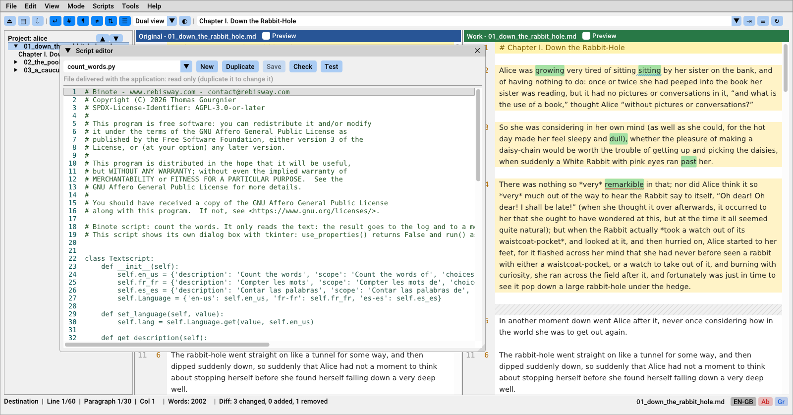

Edit, **Check** the syntax, **Test** on the current text, **New** and **Duplicate** (a delivered script is read-only: duplicate it to change it; the copy goes to `%AppData%\Binote\scripts` and replaces the delivered one of the same name). The contract of a script (properties, `Textcore` object) is described in [`binote-app/scripts/README_scripts.txt`](../binote-app/scripts/README_scripts.txt). Python 3.12 or later must be installed; it is only loaded when a script runs.

## History, notes, names, statistics

### History

Each save keeps a version of the destination (**Tools > Add a version to the history** adds one by hand, and a preference saves one automatically every 90 seconds). **Tools > Change history** (Ctrl+H, or the last button of the toolbar) shows the differences between a chosen version (red) and the current text (green); **Restore this version** brings it back, **Delete** removes it, and *Differences only* shows only the lines which changed.

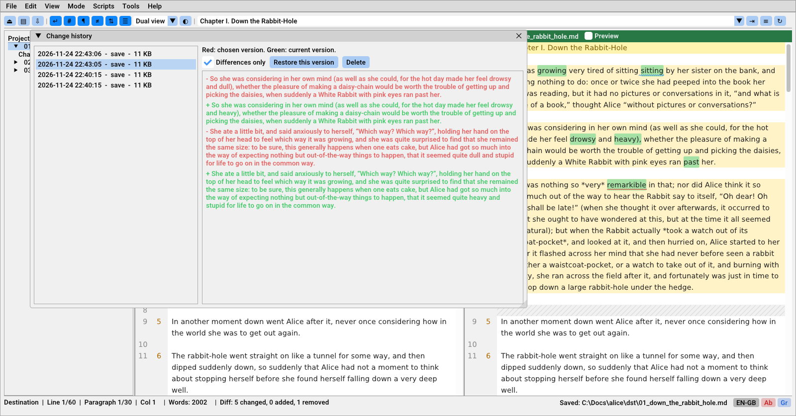

### Notes

**Note on the paragraph** (Ctrl+Alt+N) attaches a remark to a paragraph. The list of the notes opens from the menu; a click goes to the paragraph. Notes follow their paragraph when the text moves. They are kept in `binote.notes`, next to the project.

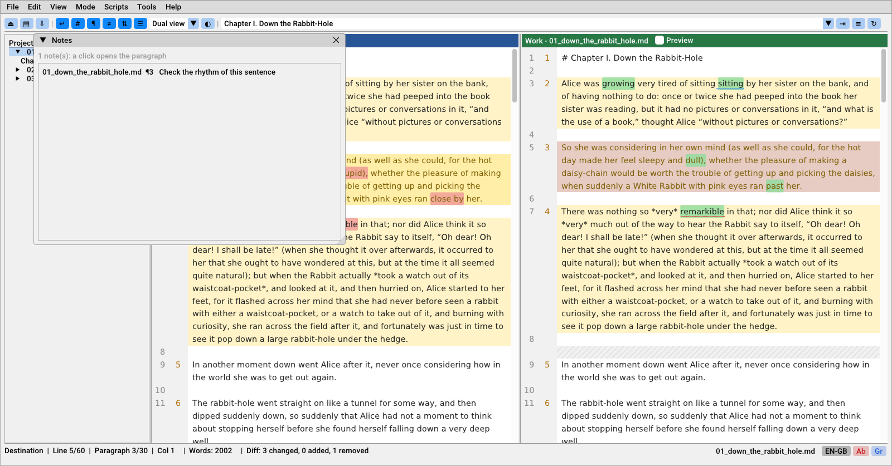

### Proper names

**Tools > Proper names of the project** lists the capitalized words which do not start a sentence, with their number of occurrences and chapters, and spellings which are probably the same name (a click prepares the replacement).

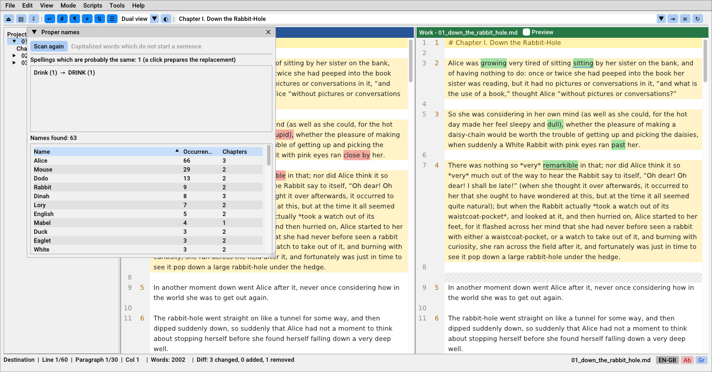

### Statistics and objectives

**Tools > Statistics** compares original and work (words, characters with and without spaces, paragraphs, lines, reading time at 230 words per minute, and the change) and, with *Count the words of the whole project*, counts the words of every chapter. **Goals** sets an objective in words per chapter and for the project; the status bar shows the progress.

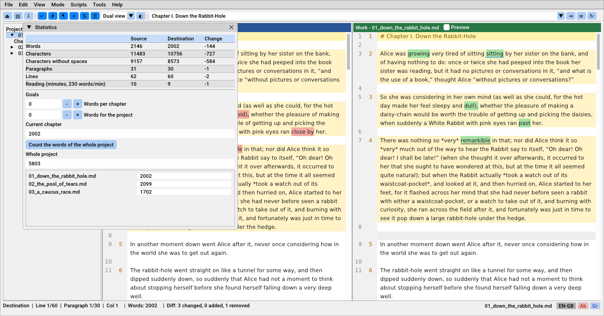

## Versions (Git and Subversion)

**File > Versions (Git / SVN)** detects a Git or Subversion working folder (the commands `git` or `svn` must be installed) and shows its branch and the changed files. The buttons: *Refresh*; *Update (pull / update)*; *Push*; *History of the file* and *Differences of the file* for the chapter which is open (*Update* saves the work first and reloads the chapter afterwards); and, below, a *Revision message* with *Commit*. A folder without a repository can be initialized with *Create a Git repository here*.

## Export

**File > Export** writes the destination of all the chapters in one file (tick *Export the original (source) instead of the destination* for the original).

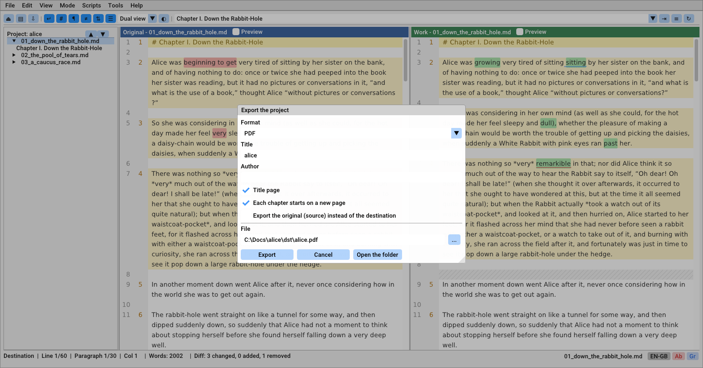

Formats: **PDF**, **Word** (.docx), **EPUB 3**, **HTML**, **Markdown** (one file). Options: *Title*, *Author*, *Title page*, *Each chapter starts on a new page*, and the *File* to write; *Open the folder* shows the result. Headings, emphasis, lists, quotes and code are kept. No external program is needed.

## Display and preferences

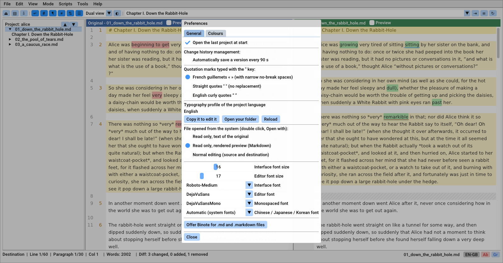

**File > Preferences** has two tabs.

**General**
- *Open the last project at start*.
- *Automatically save a version every 90 s* (the history).
- *Quotation marks typed with the " key*: French guillemets « » (with narrow no-break spaces), straight quotes (no replacement) or English curly quotes.
- *File opened from the system* (double click, *Open with*): read only as the text of the original, read only as the rendered Markdown, or normal editing.
- The size of the interface font and of the editor font, and the fonts themselves (interface, editor, monospaced, and the font for Chinese, Japanese and Korean: see [Chinese, Japanese and Korean text](#chinese-japanese-and-korean-text)).
- *Offer Binote for .md and .markdown files* adds Binote to the *Open with* list of the system.

**Colours**
- The *highlight colour of the current paragraph*: green, yellow, blue, pink, orange, or a custom one (four colours: background and text, light and dark theme).
- The *markers of the invisible characters*: one colour (with transparency) for each of the seven kinds of the colour key.
- *Restore the default colours*.

**View menu**: word wrap (Alt+Z), line and paragraph numbers, mark the differences, synchronized scrolling, the ghost lines of the aligned paragraphs, the markers of the spaces and of the invisible characters, the project tree (F9), the Original and Work views, the log (Ctrl+L) and its folder, the dark theme (Ctrl+T), a monospaced font in the editors, the highlight of the current paragraph (*None*, *Background*, *Text* or *Background + text*) and its colour, the language of the interface (English, French or Spanish), and the zoom (Ctrl++ and Ctrl+-).

**Mode menu**: *Text* or *Markdown*.

**Log** (Ctrl+L): the log of the application, for the errors of the scripts.

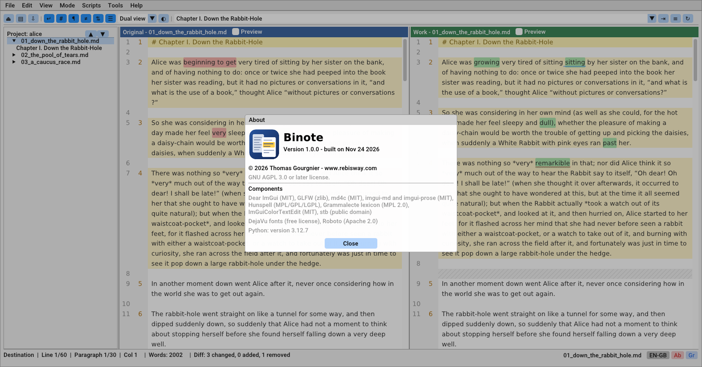

### Chinese, Japanese and Korean text

Binote shows and edits Chinese, Japanese and Korean text, in the editors, the preview and the interface:

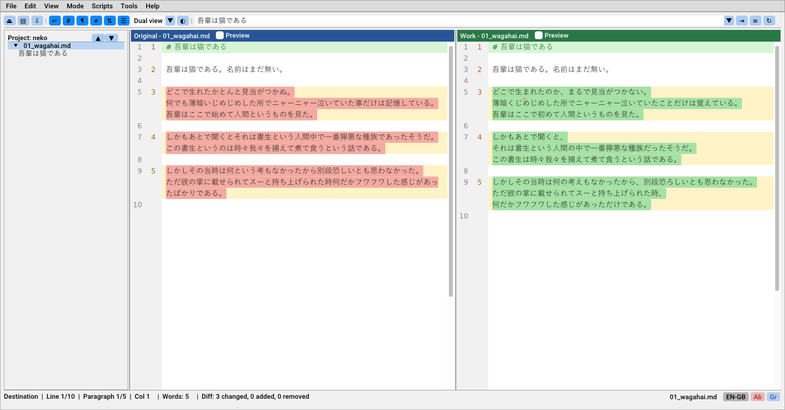

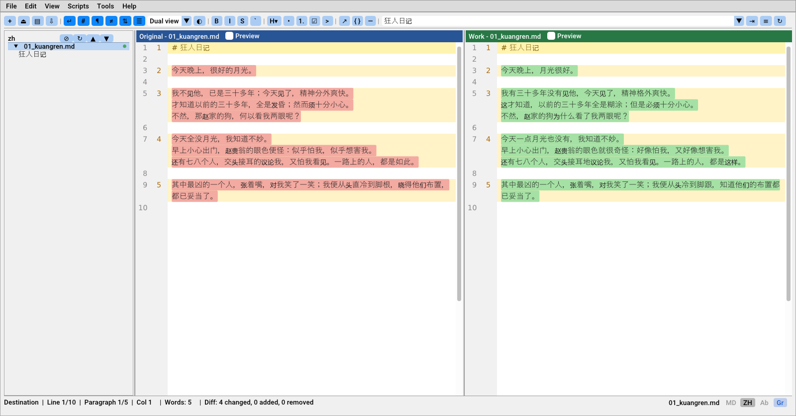

The sample projects are in [`sample-cjk`](sample-cjk) (see [`sample-cjk/CREDITS.txt`](sample-cjk/CREDITS.txt)).

- **Font**: the font of the text does not have these characters, so a second font is merged behind it. By default Binote takes the first one it finds on the system (on Windows: Yu Gothic, Microsoft YaHei, Malgun Gothic, SimSun; on Linux: Noto Sans CJK or Droid Sans Fallback). In **Preferences > General**, *Chinese / Japanese / Korean font* chooses *Automatic (system fonts)*, *None* (the characters are then not drawn) or one of the fonts of the system. A glyph is built the first time it is drawn, so the large fonts cost nothing at start.
- **Line breaking**: in word wrap, the break is moved back when it would break the rules of East Asian typography (*kinsoku*): closing brackets, stops, small kana and the prolonged sound mark do not start a line, opening brackets do not end one.
- **Input method**: the caret position is given to the input method of the system, so its candidate window opens where you type.
- The spelling and grammar checkers, the French typography and the style analysis are made for the languages of the dictionaries and engine languages (French, English, Spanish...): they have no rule for Chinese, Japanese or Korean text.

## Keyboard shortcuts

| Shortcut | Action |
| --- | --- |
| Ctrl+O / Ctrl+Shift+O | Open a file / a folder |
| Ctrl+S | Save the destination |
| Ctrl+Z / Ctrl+Y | Undo / redo |
| Ctrl+F / Ctrl+Shift+F / F3 | Find / find in all chapters / next match |
| Ctrl+G | Go to a line or a paragraph |
| Ctrl+Down / Ctrl+Up | Next / previous paragraph |
| F8 / Shift+F8 | Next / previous difference |
| F7 / Shift+F7 | Fix the typography of the paragraph / the chapter |
| Ctrl+F7 / Ctrl+F8 | Spelling / grammar on and off |
| Ctrl+F9 | List of the problems |
| Ctrl+H | History |
| Ctrl+R | Original view (reading) |
| Ctrl+T | Dark theme |
| Ctrl+L | Log |
| F9 | Project tree |
| Alt+Z | Word wrap |
| Ctrl++ / Ctrl+- | Zoom |
| Ctrl+Shift+U | Character map |
| Ctrl+Shift+Space / Ctrl+Alt+Space | No-break space / narrow no-break space |
| Ctrl+Alt+A | Align with a paragraph of the other pane |
| Ctrl+Alt+N | Note on the paragraph |
| Ctrl+click on a link | Follow the link (a click is enough in the preview) |

## Command line

```
binote.exe [file or folder] [--script FILE] [--width W] [--height H]
```

A file or a folder given on the command line is opened at start (this is also what the system passes to *Open with*). `--width` and `--height` set the size of the window. `--script` plays a test script (see [Testing](TESTING.md)).

## Files written by Binote

| File | Where | Content |
| --- | --- | --- |
| `binote.json` | project folder | name, destination folder, language, order of the chapters |
| `binote.notes` | project folder | the notes |
| `binote.align` | project folder | the alignments of paragraphs |
| `settings.ini`, `goals.ini`, `dictionary.txt` | `%AppData%\Binote` | preferences, objectives, personal words |
| `history/` | `%AppData%\Binote` | the versions of the destinations |
| `scripts/`, `scripts.ini` | `%AppData%\Binote` | your scripts and the values of their parameters |
| `grammar/` | `%AppData%\Binote` | your own languages for the grammar engine (optional) |
| `SOMMAIRE.md` | destination folder | the table of contents, when you ask for it |

The original (source) files are never modified, except in the *Original* view when you tick *Edit*.

More: [Architecture](ARCHITECTURE.md), [Building](BUILD.md), [Testing](TESTING.md), [Interface languages](LANGUAGES.md).
